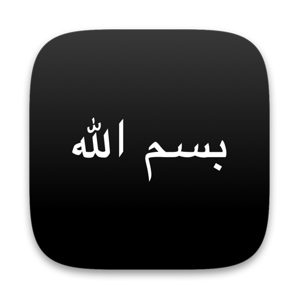

<p align="center">
  
</p>

<h1 align="center">Bismillah for Windows</h1>

<p align="center">
  Writes out the bismillah on your screen, like handwriting, every time your PC wakes.
</p>

<p align="center">
  <a href="../../releases/latest"><b>Download</b></a> ·
  <a href="#install"><b>Install</b></a> ·
  <a href="#updates"><b>Updates</b></a> ·
  <a href="#build-from-source"><b>Build from source</b></a> ·
  <a href="LICENSE"><b>MIT License</b></a>
</p>

<br>

> **Preview.** This is the Windows version of [Bismillah for Mac](https://github.com/hafizuddin-a/bismillah-menubar).
> The animation, the popups, the menu and the updater are tested on a real Windows machine, but waking from sleep, the
> lock screen and multiple monitors are still waiting for a real-PC test. If something misbehaves, please
> [open an issue](../../issues).

Bismillah is a small tray app for Windows. It shows a black popup in the middle of the screen and writes out
بسم الله الرحمن الرحيم stroke by stroke, the way Apple's "hello" animation is drawn.

- Shows when you open the app and every time your PC wakes, so it greets you when you open the lid. If the
  lid opens onto the lock screen it waits until you sign in.
- Optional **dhikr reminders**: *سُبْحَانَ ٱللَّهِ وَبِحَمْدِهِ*, *أَسْتَغْفِرُ ٱللَّهَ ٱلْعَظِيمَ* or *ٱللَّهُمَّ صَلِّ عَلَىٰ مُحَمَّدٍ* open out
  of the top of the screen at random times through the day, as many times a day as you choose.
- A tray icon with Show Bismillah, Dhikr Reminders, Launch at Login, Show on All Screens, the update options and Quit.
  No taskbar button.
- No account, and it only remembers its own settings. Its only network access is the update check (see [Updates](#updates)).
- **No admin rights needed**, to install or to update.

The letters are real font outlines revealed by a pen path that follows each letter's centreline: right to
left, one word at a time, with the dots and vowel marks added last. With Windows' animation effects turned off, it
shows the finished text without the writing.

Requires Windows 10 (version 1809) or later, 64-bit.

## Install

Open **PowerShell**: press the Windows key, type `PowerShell` and press Enter. Paste this and press Enter:

```powershell
irm https://raw.githubusercontent.com/hafizuddin-a/bismillah-startup/main/get.ps1 | iex
```

This downloads the latest release from GitHub, checks it against its published checksum, puts `Bismillah.exe` in
`%LOCALAPPDATA%\Bismillah` (a folder inside your own profile), adds a Start menu shortcut and opens it. Because it
isn't downloaded through a browser, Windows SmartScreen doesn't show its "unknown publisher" warning. The script is
[`get.ps1`](get.ps1), about 60 lines, if you'd like to read it first. Run it again any time to reinstall the latest version.

**Or by hand** (no PowerShell):

1. Download `Bismillah-<version>-win-x64.zip` from the [Releases](../../releases) page and unzip it.
2. Put `Bismillah.exe` somewhere in your own folders (for example `Documents`; avoid `Program Files`, so it can update itself).
3. Open it. If Windows SmartScreen says "Windows protected your PC", click **More info**, then **Run anyway**: the app
   isn't code-signed.
4. The bismillah is written out straight away and the icon appears in the tray. Windows hides new tray icons behind
   the **^** arrow: drag it out to the taskbar to keep it visible. Choose **Launch at Login** from its menu to have
   it start with your PC.

## Use

Click the icon in the tray:

| Item            | What it does |
|-----------------|--------------|
| Show Bismillah  | Writes it out again |
| Dhikr Reminders | Choose how many random dhikr popups a day (off by default) and the hours they appear in, see when the next one is, or show one now |
| Launch at Login | Starts Bismillah when you sign in (tick to turn on) |
| Show on All Screens | Shows the bismillah and the dhikr popups on every screen at once instead of just one (off by default) |
| Update Automatically | Checks for new versions and installs them by itself (on by default) |
| Check for Updates… | Checks right now and tells you what it found |
| Quit Bismillah  | Quits the app |
| Sincerely, @madebyhafiz | Opens the maker's Instagram |

The popup fades away by itself a couple of seconds after it finishes writing. Click it or press Esc to dismiss
it sooner.

## Dhikr reminders

Open **Dhikr Reminders** in the menu and pick how many a day: 1, 3, 5, 10, 15, 20 or 30. It is off until you choose.
At random moments, a black shape opens out of the top centre of the screen, shows one dhikr for a few seconds, then
folds back in. There is no writing animation here, just the text. Click it to dismiss it early.

- *سُبْحَانَ ٱللَّهِ وَبِحَمْدِهِ* (Subhanallahi wa bihamdihi)
- *أَسْتَغْفِرُ ٱللَّهَ ٱلْعَظِيمَ* (Astaghfirullah al-Azim)
- *ٱللَّهُمَّ صَلِّ عَلَىٰ مُحَمَّدٍ* (Allahumma salli ala Muhammad)

Each popup picks one at random, never the same one twice in a row.

- **Starts at** and **Ends at** in the submenu set the hours the popups can appear in. The default is 8:00 AM to 10:00 PM.
  The last option for the end, marked "end of day", runs through to midnight.
- The times are random but spread over those hours, at least a few minutes apart. **Next: …** in the submenu shows
  when the next one is due, and **Show Now** shows one straight away.
- Today's plan is saved, so quitting and reopening the app doesn't reshuffle it or repeat popups. If you change the
  number or the hours mid-day, only the popups still to come are re-planned.
- A popup that comes due while your PC is asleep is skipped, not shown late. If the screen is locked or the
  handwriting popup is showing, it waits a couple of minutes and tries again.
- It never takes focus, and only the black shape reacts to clicks. With animation effects off, it fades in and out
  instead of opening.

## Updates

Bismillah looks for a newer version on this repository's [Releases](../../releases) page about once a week:
shortly after it starts, or after your PC wakes, once a week has passed since the last check. When there is one
it downloads it, checks it, swaps `Bismillah.exe` in place and reopens quietly (no popup). It waits for a popup to
finish first.

- **Check for Updates…** in the menu checks straight away.
- Untick **Update Automatically** to stop the background checks. With it off, Bismillah makes no network
  requests at all and only checks when you ask.
- Every release is signed with a private key that stays on the maintainer's computer, and the matching public
  key is built into the app. An update with the wrong signature is refused, even if the file on GitHub were
  replaced.
- Updating in place needs Bismillah to sit somewhere it can write to (the install above does). From a read-only
  place it offers the release page instead.

## What it can't do

- It can't appear above the lock screen. If your PC locks while it sleeps, the popup waits and shows right
  after you sign in.
- It can't appear over a game or video running in exclusive full screen.
- The app isn't code-signed (that needs a paid certificate), so downloading it through a browser triggers SmartScreen
  (see Install). The PowerShell install above avoids this.
- The tray menu uses Windows' classic menu style, so it stays light even in dark mode.

## Build from source

You need the [.NET 10 SDK](https://dotnet.microsoft.com/download). Windows is needed to run the app; the tests and
the library build on a Mac or Linux too.

```powershell
dotnet test                                                     # unit tests
dotnet publish src/Bismillah.App -c Release -o dist/publish     # dist/publish/Bismillah.exe, one self-contained file
```

How it fits together:

- `src/Bismillah.Core`: everything that isn't drawing: the animation timeline, the dhikr scheduler, settings, update checking.
  Runs anywhere, and is unit-tested.
- `src/Bismillah.App`: the Windows app (WPF): popups, tray, wake and lock detection, the updater.
- `tools/export_data.py`: exports the letter outlines and pen strokes from the Mac app's data.
- `tools/SignTool`, `tools/update_key.swift`: make the update-signing key and sign releases.
- `tools/PreviewFrames`: draws animation frames with Skia so they can be checked on a Mac.
- Every push is built and tested on a Windows machine by GitHub Actions, which also starts the real popup windows,
  photographs the screen, and runs a full update (a signed release installs itself, a forged one is refused).

## Uninstall

Open PowerShell and paste:

```powershell
Stop-Process -Name Bismillah -ErrorAction SilentlyContinue
Remove-Item "$env:LOCALAPPDATA\Bismillah" -Recurse -Force
Remove-Item "$([Environment]::GetFolderPath('Programs'))\Bismillah.lnk" -ErrorAction SilentlyContinue
reg delete HKCU\Software\Microsoft\Windows\CurrentVersion\Run /v Bismillah /f 2>$null
Remove-Item "$env:APPDATA\Bismillah" -Recurse -Force -ErrorAction SilentlyContinue    # its saved settings
```

## License

[MIT](LICENSE). Made by [@madebyhafiz](https://www.instagram.com/madebyhafiz/).
